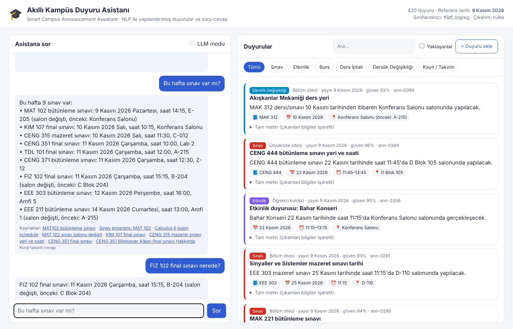

# Akıllı Kampüs Duyuru Asistanı (Smart Campus Announcement Assistant)

*NLP with Deep Learning dönem projesi: Helin Saygılı, Nisanur Kara, Cevahir Atıcı, Emre Kılıç*

**Araştırma sorusu (ara sunumdan itibaren):** Fine-tune edilmiş BERTurk, kampüs duyurularını şablon dışı metinlerde
TF-IDF + lojistik regresyon temel modelinden daha doğru (Macro-F1) sınıflandırıyor mu? "Hayır" = kazanç < 0.03 ya da
paired-bootstrap %95 güven aralığı 0'ı içeriyor. *(Öneri raporundaki soru: "NLP teknikleri dağınık duyuruları nasıl
yapılandırılmış bilgiye dönüştürebilir?" — yanlışlanamadığı için daraltıldı.)*

## Ara sunum (CSE 484/654 Mid-Project) — tek komutla tekrar üretim

```bash
pip install -r requirements.txt
python evaluation/midproject.py         # Project Card alan 8: sabit bölme (252/84/84 + 24), bootstrap CI
python evaluation/per_class_report.py   # sınıf bazında precision / recall / F1
python evaluation/error_analysis.py     # alan 9: 65 hata, 7 kategori
python presentation/build_slides.py     # sunum PDF'i (presentation/)
```

| Sistem | Test A Macro-F1 [95% CI] | Test B Macro-F1 [95% CI] |
|---|---|---|
| Anahtar kelime kuralları | 0.840 [0.76, 0.91] | 0.801 [0.60, 0.94] |
| TF-IDF + LogReg (ana temel model) | 1.000 [1.00, 1.00] | 0.874 [0.68, 1.00] |
| BERTurk (dev, 3 seed) | 0.807 ± 0.134 (dev) | test: 9 Aralık |

Sabit bölme: `data/splits/midproject_split.json` (seed 2026). Seed'ler: veri 42 · bölme 2026 · bootstrap 0 ·
BERTurk 13/42/2026. BERTurk satırı: `python evaluation/midproject.py --with-berturk` (`requirements-advanced.txt`).

**Gerçek GTÜ duyuruları:** `python scripts/collect_gtu.py --all` (veya `gtu_tum_bolumler_cek.bat`) 24 bölümün
duyurularını `data/gtu/` klasörüne indirir; `CAMPUS_FEED=gtu python run.py` (veya `baslat_gtu.bat`) asistanı bu
veriyle açar. Duyuru metinleri GTÜ'ye ait olduğu için depoya eklenmemiştir.

**Ekip:** Helin Saygılı (veri, etiketleme kılavuzu) · Nisanur Kara (research lead, bilgi çıkarımı, hata analizi) ·
Cevahir Atıcı (sınıflandırıcılar, değerlendirme, depo) · Emre Kılıç (özetleme, soru-cevap, web demo).
**AI araçları:** Claude (Claude Code) değerlendirme betikleri ve sunum taslakları için kullanıldı.

Bu depo, sunumdaki dört aşamalı sistemin çalışan bir uygulamasıdır:

```
Duyuruları topla & temizle ──► 01 Sınıflandırma ──► 02 Bilgi çıkarımı ──► 03 Özetleme ──► 04 Soru-cevap
 (web/RSS, e-posta, kulüp)     (sınav, etkinlik,     (tarih, saat, yer,    (tek cümle)      (kaynak gösteren
                                burs, iptal, ...)      ders kodu)                             cevaplar)
```

> Öğrenci: "Bu hafta sınav var mı?"
> Asistan: "Bu hafta 9 sınav var: • KIM 107 final sınavı: 10 Kasım 2026 Salı, saat 10:15, Konferans Salonu …"

## Hızlı başlangıç

📄 Adım adım kurulum ve sorun giderme için: **CALISTIRMA_KILAVUZU.pdf**

```bash
python -m venv .venv && source .venv/bin/activate      # Windows: .venv\Scripts\activate
pip install -r requirements.txt

python run.py                                          # web arayüzü → http://127.0.0.1:5000
python evaluation/evaluate.py                          # karşılaştırmalı değerlendirme → reports/
python -m pytest -q                                    # testler
```

Komut satırından:

```bash
python -m campus_assistant.cli ask "Bu hafta sınav var mı?"
python -m campus_assistant.cli ask "Are there any exams tomorrow?"
python -m campus_assistant.cli analyze --title "Sınav" --text "CENG 301 vize sınavı 20 Kasım saat 13:30'da B-204'te."
python -m campus_assistant.cli chat
```

Python 3.10+ gerekir. Çekirdek sistem yalnızca scikit-learn, numpy ve Flask kullanır, internetsiz çalışır.

## Web arayüzü



- **Asistana sor:** Türkçe ya da İngilizce soru sorulur. Her cevap kaynak duyurulara bağlantı verir.
- **Duyurular:** Kategori filtresi, arama, "yaklaşanlar" görünümü. Her kart; kategori, güven skoru, tek cümlelik özet
  ve çıkarılan bilgileri (📘 ders, 📅 tarih, ⏰ saat, 📍 yer) gösterir. Tam metinde çıkarılan varlıklar renkli işaretlidir.
- **+ Duyuru ekle:** Yeni bir duyuru yapıştırılıp anında analiz edilir. Kaydedilen duyuru hemen aranabilir olur
  (`data/user_announcements.jsonl`).
- **LLM modu:** `ANTHROPIC_API_KEY` tanımlıysa ve `anthropic` paketi kuruluysa açılır.

**Referans tarih:** "bu hafta" ve "yarın" gibi ifadeler veri setinin referans tarihine göre çözülür
(varsayılan 9 Kasım 2026, demo modu). Gerçek tarihi kullanmak için `CAMPUS_TODAY=system python run.py`,
belirli bir tarih için `CAMPUS_TODAY=2026-11-16` yazın.

## Sunumdaki yöntemler ve uygulamadaki karşılıkları

| Aşama | Sunumdaki yöntem | Uygulama |
|---|---|---|
| Toplama & temizleme | Web siteleri, e-posta, kulüpler | `scripts/collect_announcements.py` (RSS + HTML), `textutils.clean_text` |
| 01 Sınıflandırma | BERTurk / XLM-R | Temeller: anahtar kelime kuralları, TF-IDF (kelime + karakter n-gram) + NB / SVM / LogReg. İleri seviye: `training/train_transformer_classifier.py` (BERTurk `dbmdz/bert-base-turkish-cased` veya `xlm-roberta-base`) |
| 02 Bilgi çıkarımı | NER + kurallar | `extraction.RuleExtractor`: Türkçe/İngilizce tarih (14 Kasım 2026, 14.11.2026, 17-21 Kasım, Nov 14), saat (10:00, saat 14.30, saat 10'da, 4 pm), yer (B-204, Amfi 3, D Blok 105, salon sözlüğü), ders kodu; normalizasyon (ISO tarih, HH:MM). `training/train_ner.py` ile BERTurk NER eğitilir, `HybridExtractor` kural + model birleşimini kullanır |
| 03 Özetleme | mT5 / prompted LLM | Temeller: ilk cümle (lead-1), TF-IDF merkez (extractive), yapılandırılmış şablon. İleri seviye: `Seq2SeqSummarizer` (mT5) ve `LLMSummarizer` (Claude) |
| 04 Soru-cevap | Retrieval + LLM / QA | `qa.QAEngine`: soru çözümleme (ders kodu, sınav türü, zaman aralığı, kategori, sorulan şey: ne zaman / nerede / liste), TF-IDF erişimi ve yapılandırılmış filtreleme; cevaplar kaynak gösterir. Aynı konudaki çelişkili duyurularda en yenisi esas alınır, sınav salonu değişiklikleri sınav cevabına otomatik eklenir. LLM modu, yalnızca bulunan duyurulardan cevap üreten Claude çağrısıdır |
| Arayüz | Web/chat asistanı | Flask + sade HTML/JS (`campus_assistant/web`) ve CLI |

## Veri seti

`data/announcements.jsonl`: **420 etiketli duyuru** (6 kategori, %18'i İngilizce). Her kayıtta kategori, karakter
konumlu varlık etiketleri (DATE/TIME/LOCATION/COURSE), normalize alanlar ve referans özet vardır.
`data/qa_eval.jsonl`: **50 soru** (sınav ne zaman/nerede, burs son tarihi, ders iptali, etkinlik, kayıt takvimi,
"bu hafta/yarın … var mı?" listeleri, cevabı olmayan sorular). `data/challenge_set.jsonl`: şablonlardan üretilmemiş,
gerçek duyuru üslubunda **elle yazılmış 24 duyuru**.

⚠️ **Önemli:** Ana veri seti, sunumdaki 300–500 gerçek duyurunun elle etiketlenmesi tamamlanana kadar kullanılmak üzere
`scripts/generate_dataset.py` ile **sentetik olarak üretilmiştir** (tutarlı bir "kampüs dünyası": her sınavın,
etkinliğin, bursun tek bir doğru tarihi/yeri var; tekrar eden duyurular hatırlatma niteliğinde). Gerçek veriyi
toplamak için:

1. `scripts/sources.example.json` dosyasını `scripts/sources.json` olarak kopyalayıp üniversitenizin duyuru sayfalarını yazın.
2. `python scripts/collect_announcements.py` → `data/raw_announcements.jsonl`
3. `docs/annotation_guidelines.md` kurallarına göre etiketleyip `data/announcements.jsonl` ile değiştirin,
   `data/qa_eval.jsonl` için ~50 gerçek soru yazın, sonra eğitim ve değerlendirmeyi yeniden çalıştırın.

Farklı boyut veya tarihle yeniden üretmek için: `python scripts/generate_dataset.py --n 500 --base-date today`

## Değerlendirme sonuçları (`reports/evaluation_report.md`)

| Görev | Metrik | Temel model | En iyi model |
|---|---|---|---|
| Sınıflandırma (test %20) | Accuracy / Macro-F1 | Anahtar kelime: 0.881 / 0.878 | TF-IDF + LogReg: 1.000 / 1.000 |
| Sınıflandırma (elle yazılmış set) | Accuracy / Macro-F1 | Anahtar kelime: 0.792 / 0.801 | TF-IDF + LogReg: 0.875 / 0.874 |
| Bilgi çıkarımı (elle yazılmış set) | Micro P / R / F1 | – | Kurallar: 0.969 / 0.925 / 0.947 |
| Özetleme | ROUGE-1 / ROUGE-L | Lead-1: 0.471 / 0.432 | Yapılandırılmış şablon: 0.953 / 0.953 |
| Soru-cevap (50 soru) | Cevap doğruluğu / hit@1 | – | Kural + erişim: 1.000 / 1.000 |

Sentetik veri setindeki skorlar iyimserdir, çünkü kurallar ve şablonlar ortak bir dil kullanır (çıkarım orada
1.000 çıkar). Gerçekçi tablo için elle yazılmış set ve gerçek veri kullanılmalıdır. Soru-cevap değerlendirmesi uçtan
uca çalışır: altın etiketler değil, 5 katlı çapraz doğrulamayla **tahmin edilen** kategoriler ve **çıkarılan** alanlar kullanılır.

## İleri seviye modeller (GPU önerilir)

```bash
pip install -r requirements-advanced.txt
python training/train_transformer_classifier.py --model dbmdz/bert-base-turkish-cased   # → models/classifier_transformer
python training/train_transformer_classifier.py --model xlm-roberta-base                # karşılaştırma için
python training/train_ner.py --model dbmdz/bert-base-turkish-cased                      # → models/ner
python evaluation/evaluate.py --with-transformers        # BERTurk, NER (hibrit), mT5 karşılaştırması
export ANTHROPIC_API_KEY=...                              # LLM modu (özet + kaynaklı soru-cevap)
python evaluation/evaluate.py --with-llm
```

`models/` altında eğitilmiş model bulunduğunda web uygulaması onları otomatik kullanır (sınıflandırıcı:
transformer > TF-IDF, çıkarım: hibrit > kurallar). LLM modeli varsayılan olarak `claude-opus-5-5`'tir,
`CAMPUS_LLM_MODEL` ile değiştirilebilir. API hatasında veya reddedilen istekte sistem kural tabanlı cevaba döner.

## Proje yapısı

```
campus_assistant/
  textutils.py        Türkçe küçük harf, cümle bölme, tarih biçimleme, dil tespiti
  classification.py   Anahtar kelime / TF-IDF (NB, SVM, LogReg) / Transformer sınıflandırıcıları
  extraction.py       Kural tabanlı + hibrit (NER) bilgi çıkarımı ve normalizasyon
  summarization.py    Lead-1, extractive, şablon, mT5, LLM özetleyiciler
  pipeline.py         Ham duyuru → yapılandırılmış kayıt (kategori, varlıklar, alanlar, özet)
  qa.py               Soru çözümleme, erişim, kaynaklı cevap üretimi (kural / LLM)
  llm.py              İsteğe bağlı Claude entegrasyonu
  metrics.py          P/R/F1, Macro-F1, ROUGE-1/2/L
  service.py, cli.py  Uygulama servisi ve komut satırı
  web/                Flask uygulaması (sohbet + duyuru akışı)
scripts/              Veri seti üretimi, duyuru toplama
training/             TF-IDF, BERTurk/XLM-R sınıflandırıcı ve NER eğitimi
evaluation/           Karşılaştırmalı değerlendirme → reports/
data/                 Duyurular, QA soruları, elle yazılmış zor set
docs/                 Etiketleme kılavuzu
tests/                pytest testleri
```

## 12 haftalık plana göre durum

| Hafta | Plan | Bu depoda |
|---|---|---|
| 1–4 | Veri toplama, etiketleme, temel modeller | Toplayıcı betik, etiket şeması ve kılavuzu, sentetik başlangıç verisi, tüm temel modeller ✔ |
| 5–7 | Sınıflandırma ve çıkarım modellerinin ince ayarı | BERTurk/XLM-R sınıflandırma ve NER eğitim betikleri hazır (GPU'da çalıştırılmalı) |
| 8–9 | Özetleme ve soru-cevap | Extractive/şablon/mT5/LLM özetleme, erişim + kaynaklı QA ✔ |
| 10–12 | Entegrasyon, değerlendirme, demo | Web + CLI arayüzü, değerlendirme raporu, testler ✔ |

Gerçek duyuruların toplanıp etiketlenmesi ve transformer modellerinin GPU'da eğitilmesi ekip tarafından yapılmalıdır.
